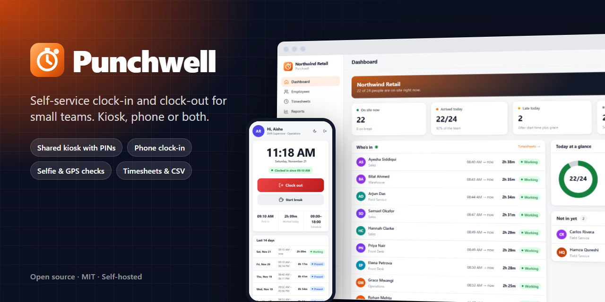
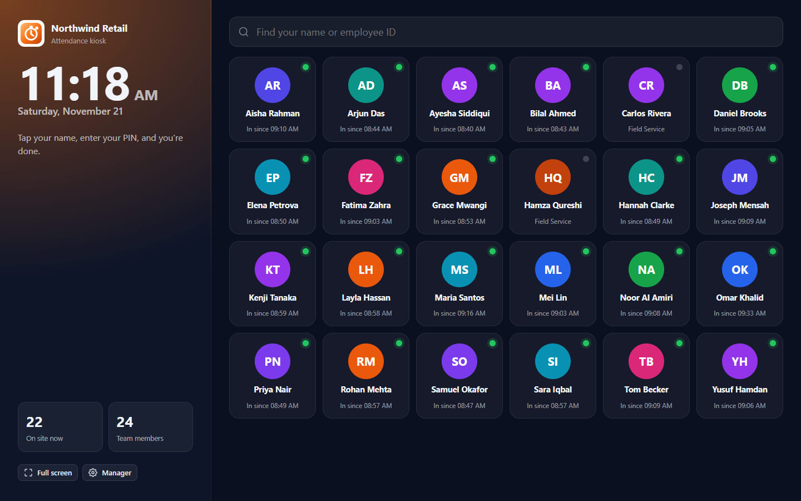
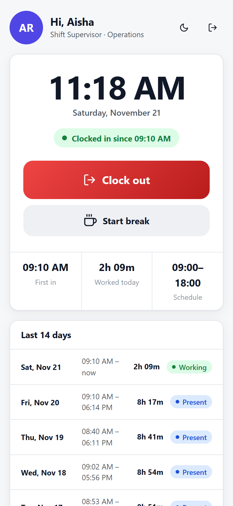
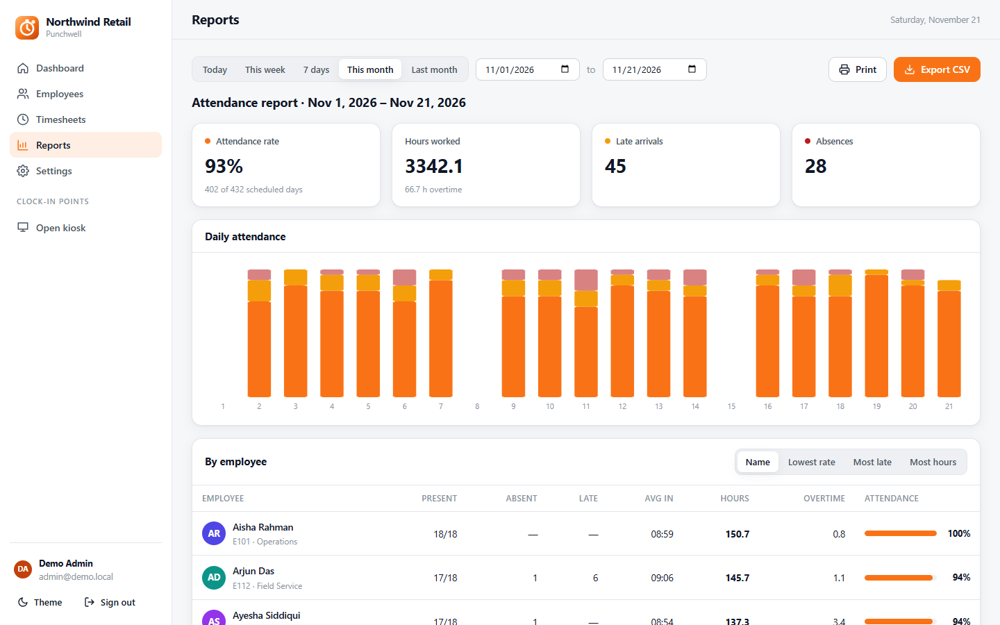

# Punchwell

**Self-hosted employee clock-in and clock-out for small teams.** Put a tablet at the door as a shared kiosk, let staff clock in from their phones, or both. Punchwell works out hours, breaks, late arrivals and overtime, then gives you timesheets and attendance reports ready to export. You don't need a fingerprint device, a subscription or a cloud account.

[Try the live demo](https://punchwell.92.4.64.89.sslip.io) · [Open the demo kiosk](https://punchwell.92.4.64.89.sslip.io/kiosk) · [Report an issue](https://github.com/MusaBukhari237/punchwell/issues)

[](https://punchwell.92.4.64.89.sslip.io)

> Demo logins are on the sign-in page (manager `admin@demo.local` / `demo1234`, employee `E101` / PIN `1234`). The data is synthetic and resets every few hours.

## Who it's for

Shops, cafés, clinics, salons, workshops, warehouses, offices and small factories with roughly 5–300 hourly or salaried staff. If all you need is "who came in, when, and for how long", Punchwell does it without an HR suite.

## Features

| | |
|---|---|
| **Shared kiosk** | Staff tap their name and enter a 4–8 digit PIN on any tablet or PC. Big buttons, a live clock and a greeting confirm each punch. Wrong-PIN attempts are rate-limited. |
| **Phone clock-in** | Employees sign in with their ID and PIN on their own phone (installable as a PWA). Optional GPS capture with every punch. |
| **Anti buddy-punching** | Optionally require a selfie when clocking in or out. Managers see the photo next to the punch. |
| **Breaks** | Start and end breaks. Break time is subtracted from worked hours. |
| **Live dashboard** | See who's on site now, who's on break and who hasn't arrived yet, plus a two-week attendance trend and an activity feed. |
| **Timesheets** | Filter by date range, person and status. Open any day to fix, add or delete punches. Every change is written to the audit log. |
| **Reports** | Attendance rate, late arrivals, absences, hours, overtime and average clock-in time per person. Print or export CSV. |
| **Rules** | Work hours, grace period, working days and timezone. |
| **Branding** | Upload your logo and pick an accent colour, or ship a `brand/brand.json` for a white-label deployment. |
| **Light and dark themes** | Readable on a bright shop floor and a dim warehouse. |

| Kiosk | Phone | Reports |
|---|---|---|
|  |  |  |

## Quick start

### Docker (recommended)

```bash
git clone https://github.com/MusaBukhari237/punchwell.git
cd punchwell
docker compose up -d
```

Open http://localhost:3000 and sign in with the `ADMIN_EMAIL` / `ADMIN_PASSWORD` from `docker-compose.yml`. Change the password straight away.

### Node.js

You need Node.js 22.13 or later. There's nothing to install: Punchwell uses Node's built-in SQLite and has no npm dependencies.

```bash
npm start            # http://localhost:3000, guided first-run setup
DEMO=1 npm start     # with sample data
npm test
```

## Configuration

| Variable | Default | Purpose |
|---|---|---|
| `PORT` | `3000` | HTTP port |
| `DATA_DIR` | `./data` | Where the SQLite database and session key are stored. Back this up. |
| `ADMIN_EMAIL`, `ADMIN_PASSWORD` | – | Creates the first manager on an empty database. Without them, the first visit shows a setup screen. |
| `SESSION_SECRET` | random, saved in `DATA_DIR` | Signs session cookies |
| `DEMO` | off | `1` seeds sample data and shows demo logins |
| `DEMO_RESET_HOURS` | `0` | With `DEMO=1`, wipe and reseed every N hours |
| `BRAND_DIR` | `./brand` | Folder with `brand.json` (`appName`, `companyName`, `tagline`, `accent`, `accentInk`, `theme`, `logo`) and the logo file |
| `APP_NAME` | `Punchwell` | Product name shown in the UI |

Put Punchwell behind HTTPS in production. Browsers only allow camera and location access on secure origins.

## How times are calculated

- A day's worked time is the sum of every clock-in → clock-out span minus breaks.
- A person is **late** when their first clock-in is after the start time plus the grace period.
- **Overtime** is anything worked beyond the scheduled day length. Every minute worked on a non-working day counts as overtime.
- A past day with a clock-in but no clock-out is flagged **No clock-out** so a manager can fix it.

## Tech

Node.js 22 with the built-in `node:sqlite` module, a ~400-line HTTP layer with no framework, and a Preact + htm UI that's vendored, so there's no build step. Passwords and PINs are hashed with scrypt, and sessions are HMAC-signed, HTTP-only cookies.

## Related projects

- **[Musterdesk](https://github.com/MusaBukhari237/musterdesk)**: a supervisor marks a whole crew present in one tap. Offline, with a desktop app.
- **[Rostermark](https://github.com/MusaBukhari237/rostermark)**: shifts, geofencing, leave approvals, multiple sites and a REST API.

## Sponsors

Supported by [LeadCeleris](https://www.leadceleris.com/) and [AIFFICIENTO](https://www.aifficiento.biz/).

## Contributing

Read [CONTRIBUTING.md](CONTRIBUTING.md) and [SECURITY.md](SECURITY.md). Released under the [MIT license](LICENSE).

<sub>Keywords: employee time clock, attendance app, clock in clock out, time and attendance, kiosk time clock, PIN time clock, timesheet software, self-hosted attendance system, open source time tracking, small business HR.</sub>
